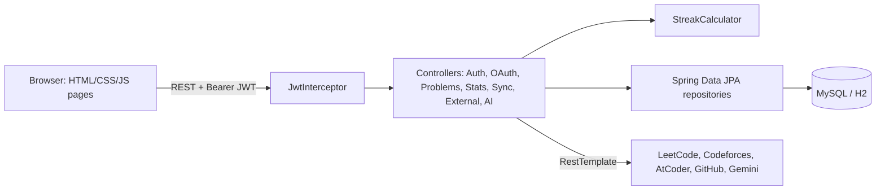

# CodeInsight

A full-stack platform for tracking competitive-programming practice: log problems, build streaks, review with spaced repetition, and see analytics across LeetCode, Codeforces, AtCoder, CodeChef and GitHub.

**Stack:** Java 17, Spring Boot 3, Spring Data JPA, MySQL (H2 for zero-setup dev), JWT + GitHub OAuth 2.0, REST, vanilla JS + Chart.js, JUnit 5 + MockMvc, Docker, GitHub Actions.

## Features
- **Auth:** register/login with BCrypt + JWT, "Continue with GitHub" (OAuth 2.0 authorization-code flow with CSRF `state`), login rate limiting
- **Problem tracker:** CRUD, search, filters, pagination, Kanban board (drag and drop), CSV export, revision flags
- **Analytics dashboard:** streaks, 17-week heatmap, charts by difficulty/topic/platform, weekly trend, smart insights, XP levels, achievements, click-through charts
- **Spaced repetition:** reviews scheduled at 3, 7, 21, 45 days, flashcard review mode
- **Integrations:** LeetCode submission sync, profile stats from LeetCode, Codeforces, AtCoder, GitHub, CodeChef (best effort), AI hints via Gemini
- **UX:** command palette (Ctrl+K), shortcuts, dark mode, responsive glass UI
- **Quality:** unit + integration tests, CI, Swagger docs, validation with clean JSON errors

## Architecture

Flow: login returns a signed JWT; the interceptor validates it on every `/api/**` call (except `/api/auth/**`) and puts the `userId` on the request, so every query is scoped to the logged-in user.

## Run it (VS Code)
**Needs:** JDK 17+, Maven 3.8+ (`mvn -v`), VS Code "Extension Pack for Java".

1. Open this folder in VS Code.
2. **Quickest (H2 database, no setup):** run the *CodeInsight (H2 - no setup)* config from Run and Debug, or `mvn spring-boot:run`.
3. Open http://localhost:8080 and register.

**With MySQL:**
```bash
docker compose up -d db                 # starts MySQL only
mvn spring-boot:run -Dspring-boot.run.profiles=mysql
```
(or pick *CodeInsight (MySQL)* in VS Code). **Everything in Docker:** `docker compose up --build`.

**Tests:** `mvn test`   **API docs:** http://localhost:8080/swagger-ui.html

## Configuration (environment variables)
| Variable | Purpose | Default |
|---|---|---|
| `JWT_SECRET` | JWT signing key (32+ chars) | dev value, change it |
| `DB_HOST`, `DB_NAME`, `DB_USER`, `DB_PASSWORD` | MySQL profile | localhost, codeinsight, root, root |
| `GEMINI_API_KEY` | enables AI hints | off |
| `GITHUB_CLIENT_ID`, `GITHUB_CLIENT_SECRET` | enables GitHub login | off |

**GitHub login setup:** GitHub > Settings > Developer settings > OAuth Apps > New. Homepage `http://localhost:8080`, callback `http://localhost:8080/api/auth/github/callback`. Set the two variables and restart; the button appears on the login page.

## API (all but `/api/auth/**` need `Authorization: Bearer <token>`)
| Method | URL | Description |
|---|---|---|
| POST | /api/auth/register, /api/auth/login | create account / get JWT |
| GET | /api/auth/github | start GitHub OAuth |
| GET, POST | /api/problems | list (filters: search, difficulty, status, platform, revision) / create |
| PUT, DELETE | /api/problems/{id} | update / delete |
| GET | /api/problems/due | reviews due today |
| POST | /api/problems/{id}/reviewed | log a review |
| GET | /api/stats | dashboard numbers |
| POST | /api/sync/leetcode/{user} | import recent accepted submissions |
| GET | /api/external/{leetcode,codeforces,atcoder,github,codechef}/{user} | profile stats |
| POST | /api/ai/hint | AI hint (no full solutions) |

## Design decisions
- **JWT in a `HandlerInterceptor`** instead of full Spring Security: smaller surface to understand, still stateless. Trade-off: no built-in CSRF/role support; a production version would move to Spring Security.
- **Streak logic in `StreakCalculator`**, separate from the controller, so it is unit tested without a database.
- **H2 by default, MySQL by profile**, so anyone can run the project in one click while production-style setup stays available.
- **Server-side ownership checks** on every problem lookup, covered by a test that one user cannot see another's data.

## Known limitations / next steps
LeetCode and CodeChef data come from unofficial endpoints and may break. Tokens live in `localStorage` (an httpOnly cookie would be safer). Possible next steps: scheduled auto-sync, refresh tokens, Spring Security migration, Flyway migrations.

## v3.1
Account settings panel in the bottom-left of the sidebar (profile, accent color presets, dark mode, particle toggle, daily goal, change password, delete account).
Backend: `POST /api/account/password`, `POST /api/account/delete`. Accent colors drive the whole UI; richer hover effects and click ripples.

## v3.2
Timer removed. Account settings redesigned: tabbed panel (Profile with live stats, Appearance with accent swatches and toggle switches, Goals stepper, Security with strength meter and confirm field, Danger zone that unlocks only when you type your username).
